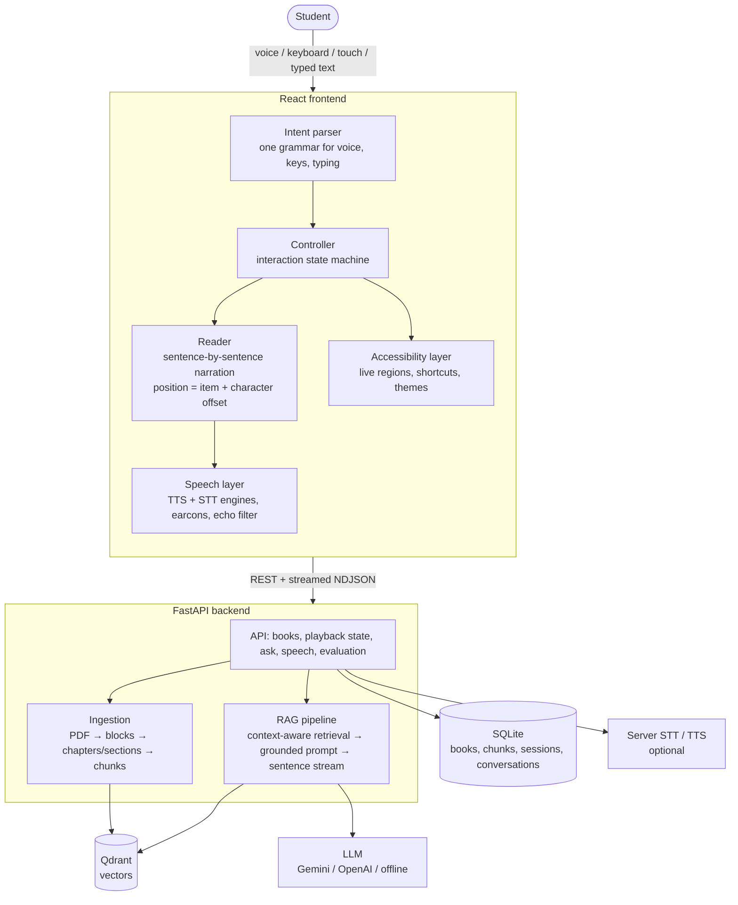
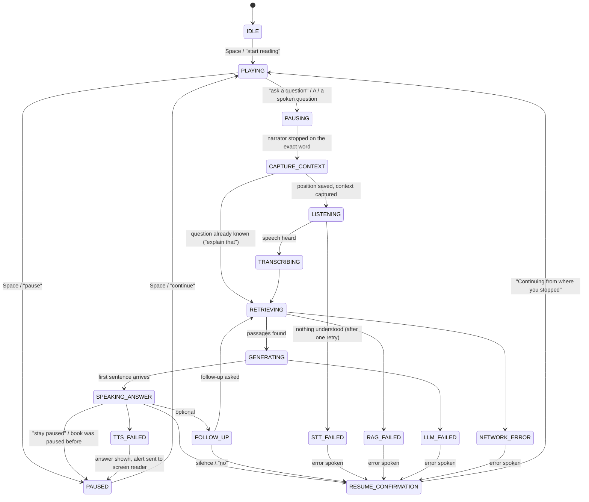

# Accessible RAG Audiobook

**An AI-powered interactive audiobook for blind and visually impaired students.**

The app reads a textbook aloud. At any moment the student can interrupt it by voice, ask a question about what they
are hearing, get a spoken answer grounded in the textbook, and have the book carry on **from the exact word where it
stopped**. It is a reading companion, not a chatbot: the book is always the main thing, and questions are a detour
that returns you to your place.

```
PLAYING → PAUSING → CAPTURE_CONTEXT → LISTENING → TRANSCRIBING → RETRIEVING
        → GENERATING → SPEAKING_ANSWER → RESUME_CONFIRMATION → PLAYING
```

## Quick start

Requirements: Python 3.11+, Node 20+. No API keys are needed to try it.

```bash
# 1. Backend  (http://localhost:8000)
cd backend
python -m venv .venv
.venv\Scripts\activate            # macOS / Linux: source .venv/bin/activate
pip install -r requirements.txt
copy .env.example .env            # optional: add GROQ_API_KEY (GPT-OSS), XAI_API_KEY (Grok), GEMINI_API_KEY or OPENAI_API_KEY
uvicorn app.main:app --reload

# 2. Frontend  (http://localhost:5173)
cd frontend
npm install
npm run dev
```

Open **http://localhost:5173 in Chrome or Edge**, press Enter, and allow the microphone. Use headphones if you can.
Two sample textbooks are prepared automatically on first start.

Or with Docker (includes a Qdrant server): `docker compose up --build`, then open http://localhost:8080.

### What works without API keys, and what the keys add

| Part | No keys (offline) | With an API key (Groq, xAI, Gemini or OpenAI) |
|---|---|---|
| Reading aloud, exact resume, voice commands, contents, find, skim, notes, all accessibility features | Yes | Yes |
| Speech recognition | Browser (Chrome, Edge, Safari) | Browser, or Whisper (Groq / OpenAI) or Gemini on the server for other browsers |
| Search, for answers and for "find" | Qdrant with a local lexical embedding (matches words, not meanings) | Semantic embeddings with a Gemini or OpenAI key (Groq and xAI have none, so search stays lexical) |
| Answers | **Quoted** from the most relevant textbook sentences | **Generated** by the LLM: paraphrased, simplified, with examples |
| Free-form requests ("my eyes hurt") | Built-in grammar only | Interpreted by the LLM |
| Pictures | Passed over | With a vision model (Groq `GROQ_VISION_MODEL`, Gemini, OpenAI or xAI): every picture in a PDF is described when the book is added - expressions, feelings, textures, sounds and positions for story illustrations; structure and meaning for diagrams - and read aloud, after a chime, where the picture sits. Books added earlier must be uploaded again to get descriptions |
| Hearing commands | The browser's own recogniser (Chrome, Edge, Safari) | With a speech service on the server (Groq or OpenAI Whisper): the microphone is opened with echo cancellation, so the app's own voice is removed from what it hears; speech is cut into utterances as people start and stop talking (nothing is sent in silence); each utterance is transcribed by Whisper, with a vocabulary hint and a filter for the words Whisper invents for noise. The narrator makes way the moment a voice is heard. Falls back to the browser's recogniser if the service cannot be reached. Choose under Settings > "How I listen" |
| Understanding commands | Built-in grammar: many English phrasings, plus the essential commands in Hindi, Marathi and Hinglish | The same grammar for exact commands (instant), and the language model for everything else: indirect requests, Indian English, Hindi / Marathi / Hinglish in either script. If the model is slow (4 s) or fails, the grammar's own reading is used |
| Voice | Indian English voices (Neerja, Prabhat) by default on a device set up for India; Microsoft *Multilingual* neural voices via `edge-tts` (natural, free, needs internet; 12 to choose from in Settings, or say "male voice" / "female voice" / "change the voice"). Text in Hindi, Arabic, Chinese and other non-Latin scripts is routed to a native voice for that language; Spanish, French, German etc. are read in-language by the same voices. Falls back to the device's voices, and says so | The same, or OpenAI TTS (`TTS_PROVIDER=openai`, with narration-style instructions) |

The offline answerer and embedder are real but simple, clearly marked `LOCAL FALLBACK` in the code, and the UI says
"Offline mode" whenever one produced the answer. For a demonstration, add a key: "explain this simply" and
"give me an example" need a language model to do well. Switching embedding provider re-indexes books automatically.

## The demo (about two minutes)

1. Open the app, press **Enter**, then press **1** (or say "open Operating Systems").
2. Say **"next chapter"** twice, or type `go to chapter 3` in the command box, to reach *Virtual Memory*.
3. Let it read: *"Virtual memory allows a process to use more memory than is physically available…"*
4. Interrupt mid-sentence: say **"What is virtual memory?"** (or press **A** and ask, or type it).
5. The book stops on that word. You hear *"Searching your textbook"*, then the answer in a second voice,
   then *"Continuing from where you stopped"*, and the narrator picks up from the same word.
6. Follow up with **"Why is it needed?"** then **"Give me an example"**: the conversation remembers what "it" is.
7. Try **"Explain this simply"**, **"Where am I?"**, **"Go back 30 seconds"**, **"Quiz me"**.
8. Open *Interaction trace* at the bottom of the player to show the state machine that just ran.

Then the study tools (another two minutes):

9. **"Find where it talks about the dirty bit."** It searches the book, jumps to that sentence in another chapter
   and keeps reading. **"Return to my place"** brings you back to the word you left.
10. **"Read the contents"**, then **"Go to the section on page faults"**.
11. **"Skim."** You hear only the first sentence of each paragraph, with a tick at each skip. When something
    matters, say **"Read this part"** to hear that paragraph in full.
12. **"Note that page faults are normal, not errors."** Then **"Read my notes"**, and **"Export my notes"** to
    download one text file with your notes, bookmarks, questions and answers.
13. **"Yellow theme"**, **"Bigger text"**, **"Stop reading in twenty minutes"**: settings and the sleep timer by voice.
14. Without a screen reader running, press **Tab**: the app names each control it lands on.

## Architecture



### The interaction flow



Every error state speaks what went wrong in plain words and then returns the student to the book. Nobody is left in
silence wondering what happened.

### Project structure

```
accessible-audiobook/
├── ingestion/                 standalone: python -m ingestion book.pdf
│   ├── pdf_parser.py          PDF/text → headings + paragraphs (font-size and numbering heuristics)
│   ├── chunker.py             sentence splitting, section-bounded paragraph chunks
│   ├── embeddings.py          Gemini / OpenAI / local embedders
│   └── vector_store.py        Qdrant (server or embedded)
├── backend/app/
│   ├── api/                   auth, books + playback state + bookmarks + notes + study sheet, qa + find,
│   │                          assistant (free-form requests), speech, evaluation
│   ├── models/                tables.py (schema), schemas.py (validation)
│   ├── rag/                   retriever (answers and find), prompts, answerers, pipeline (streaming), quiz
│   ├── speech/                server STT and TTS providers
│   ├── audiobook/             reading structure and precise position persistence
│   └── services/              providers, ingestion job, sample seeding, security, evaluation metrics
├── backend/sample_data/       two original sample textbooks
├── frontend/src/
│   ├── core/                  controller (state machine), reader, intents, settings-by-voice, echo filter, tts, stt, earcons
│   ├── accessibility/         live-region announcer, keyboard shortcuts, app-wide voice layer, spoken focus
│   ├── components/ pages/ hooks/ services/ types/
└── docs/                      SPEC.md (project brief), HCI_EVALUATION.md (study protocol)
```

### Data model

`User`, `Book → Chapter → Section → DocumentChunk`, `ReadingSession` (current precise position, one per user and
book), `PlaybackState` (append-only checkpoint at every interruption), `Conversation → ConversationMessage`,
`Bookmark`, `Note` (pinned to a sentence), and for the study `EvalParticipant → EvalTrial`, `EvalQuestionnaire`.
See `backend/app/models/tables.py`. A database created by an earlier version is brought up to date at start-up
(`add_missing_columns`, `backfill_paragraphs`) without changing any chunk id, so reading positions, bookmarks and
notes survive upgrades.

A position is `(chunk_id, sentence_index, character_offset)` plus an estimated `audio_time`. It is not a page number
or a timestamp, which is why resuming is exact at any speed and with any voice.

## Design decisions

**Sentence-by-sentence narration.** Each sentence is one utterance, and word-boundary events update a character
offset. "Pause" is cancel-and-remember rather than the browser's unreliable pause, so resuming is simply "speak the
rest of this sentence from offset *n*". Voices that report no word boundaries fall back to an estimate from elapsed
time and a continuously calibrated speaking rate.

**The reading position is part of the question.** "Why is this necessary?" is meaningless alone. Retrieval combines
semantic similarity, lexical overlap, and proximity to the reading position; the passage being read and its
neighbours are always candidates. Contextual requests ("explain that") search with the heard text itself. The prompt
tells the model what was just heard, which sentence was interrupted, and whether each passage was already heard, is
being read, or comes later in the book.

**Chunks never contain overlap.** Overlap would make the audiobook read sentences twice. It is stored separately and
used only in the text that is embedded.

**Answers are written for the ear.** The prompt forbids markdown, lists and visual references, asks for the direct
answer first in short sentences, and the server strips any markdown that slips through. Answers stream sentence by
sentence, so speech starts while the rest is still being generated.

**Everything can be done by talking.** One voice layer runs on every screen. Navigation ("go to settings"), every preference ("yellow theme", "bigger text", "short answers", "what are my settings"), the library ("open operating systems", "tell me about data structures") and the player all work by voice; the only exception is choosing a file to upload, which browsers do not allow without the keyboard. When a language model is configured, any phrase the built-in grammar does not recognise is sent to it (`/api/assistant/interpret`) and mapped to a command, a question about the book, a short spoken reply, or ignored as background talk. With `GROQ_API_KEY` set, answers and this routing use OpenAI's open-weight GPT-OSS on Groq, and Groq's Whisper provides speech recognition for browsers without their own.

**Commands are understood in two passes.** Exact phrases first; then a looser key-word pass ("could you take me back a little", "I didn't catch that"). Loose matches are trusted less: unlike exact phrases, they must pass the echo filter, so the narrator's own words cannot trigger them.

**A natural voice by default.** The backend synthesises each sentence with a neural voice and returns per-word timings, so exact-word resume still works; sentences are fetched one ahead and cached. `edge-tts` uses an unofficial Microsoft endpoint, so for anything beyond a prototype switch to a licensed provider. If a sentence cannot be fetched within eight seconds, the device voice reads it, and keeps reading for a minute before the natural voice is tried again, so a broken connection costs one pause rather than one per sentence.

**Two voices.** The narrator and the assistant use different voices (or a different pitch on single-voice devices),
so "the book" and "the answer" are distinguishable by ear alone.

**Earcons carry system status.** A rising tone means the microphone is open, a soft tick means "still working", a
low buzz means an error. Tones are faster than words and do not get transcribed by the recogniser. Verbosity is
adjustable: full sentences, short words, or sounds only.

**An open microphone hears the book.** A transcript is treated as echo when most of its word trigrams match what is
being spoken now or finished within the recogniser's lag. Older speech is deliberately excluded: a student may ask
"what is virtual memory?" seconds after a heading with those exact words was read (a bug the tests caught). Fixed
command phrases are always accepted. Headphones are still recommended.

**Barge-in.** The narrator stops as soon as it hears the student begin to speak, rather than talking over the
question. If the speech turns out not to be for the app, reading continues from the same word.

**Screen readers and the app's own voice must not collide.** A first-run question asks whether a screen reader is in
use. If so, status messages go to ARIA live regions and the app stays quiet; the book and answers are still read by
the app. The player's control group uses `role="application"` so single-key shortcuts reach the page.

**Everything that can be said can be typed.** The command box serves braille-display users, people who cannot or
prefer not to speak, and noisy rooms, and is the automatic fallback when the microphone is blocked.

**Skimming by ear.** Sighted readers skim a page in seconds; a listener cannot. Skim mode reads headings and the
first sentence of each paragraph, with a tick at every skip, and "read this part" drops back to the start of the
current paragraph in full. This needs real paragraph boundaries, which ingestion records for every chunk.

**Jumping is safe because it can be undone.** Any jump (a section, a chapter, a page, a search hit, a bookmark, a
note) remembers the exact word that was left, and "return to my place" goes back to it. A run of jumps while
browsing keeps only the place originally left, since that is what a listener means by "my place".

**Find is navigation, not an answer.** "Find where it talks about X" uses the same vector search as question
answering but ignores the reading position, picks the single best sentence, and starts reading there. When nothing
really matches it says so rather than jumping somewhere arbitrary. "Go to the section on X" tries the headings
first and falls back to this.

**The app names its own controls.** A blind person without a screen reader would hear nothing when tabbing through
buttons. With "spoken guidance", each control is named as the keyboard reaches it ("Ask a question, button,
shortcut A"), including its state and any hint. It only speaks after a navigation key, never when focus is moved by
the app or the mouse, and is off in screen-reader mode. In the player it goes through the controller, so the
narrator pauses for it and carries on from the same word.

**Reopening a book is not the same as resuming after a question.** Seconds after an interruption the exact word
is the right place to restart. Days later it is not: the book starts from the beginning of the sentence, after
saying which chapter and section you are in.

**No sign-in wall.** A guest account is created silently; registering later upgrades it in place.

**Resume on the exact word by default**, with "start of the sentence" and "one sentence earlier" as options, since
some listeners prefer a run-up. Which is best is a question for the study.

### HCI principles, and where each lives

| Principle | In the product |
|---|---|
| Visibility of system status | Spoken status, thinking tick, status orb with word and icon, always-visible microphone state |
| User control and freedom | Space always pauses; "cancel", "stay paused", "continue reading"; answers can be cut short; skim or read in full |
| Recoverability | Position checkpointed on every interrupt, page hide and periodically; every error returns to the book; "return to my place" undoes any jump |
| Error prevention | Upload checked before sending; echo filter; one automatic retry before giving up on speech |
| Recognition over recall | Flexible phrasing; quick-action buttons; "what can I say?"; shortcuts printed on buttons |
| Consistency | Voice, keys, touch and typing all produce the same `Intent`, handled in one place |
| Minimal cognitive load | One big play button, one big ask button; no navigation during a question |
| Multimodal feedback | Speech, earcons, vibration, large text, word highlighting, ARIA live regions, spoken control names |
| Flexibility | Speed, voices, verbosity, resume point, themes, text size, motion, always-on or push-to-ask |

### Accessibility checklist

Semantic landmarks and headings; skip link; focus moved to the page heading on navigation; 4px focus ring; three
themes at AAA text contrast (dark, yellow-on-black, light); text scaling to 200%; Atkinson Hyperlegible typeface;
56px minimum targets; reduced-motion support; Windows forced-colours support; state never shown by colour alone;
labelled controls with `aria-keyshortcuts`; native modal dialogs; charts with a table alternative.

## Security

API keys live only in `backend/.env` and are never sent to the browser. JWT bearer auth on every endpoint;
passwords hashed with PBKDF2-SHA256. Uploads are limited by size, extension and content signature, and are stored
under a server-generated name. Books are private to their uploader. All request bodies are validated. Participant
data can be protected with `RESEARCHER_PASSCODE` and deleted on withdrawal.

## Testing

```bash
cd backend  && python -m pytest tests -q     # 24 tests: ingestion, retrieval, find, notes, API, playback state, upgrade, evaluation
cd frontend && npx vitest run                # 216 tests: command grammar, echo filter, reader, state machine, study tools, voices
cd frontend && npm run build                 # type-check and production build
python -m ingestion path/to/book.pdf         # from the repo root: preview how a PDF will be chunked
```

The state-machine tests (`frontend/src/core/controller.test.ts`) run the whole interrupt → ask → answer → resume
flow with fake speech engines and assert the exact word of resumption, the context sent to retrieval, the spoken
feedback, and each failure path. `study.test.ts` does the same for the contents, find, return, skim, sleep timer
and notes. The API tests run the real pipeline with the offline providers.

Manual checks worth doing before a demo: keyboard only; NVDA or VoiceOver with "I use a screen reader" on; 200%
text; each theme; microphone denied; backend stopped mid-question (you should hear the network error and return to
the book).

## Known limitations

- Continuous voice commands need the Web Speech API (Chrome, Edge, Safari). Firefox falls back to push-to-ask with
  server transcription, or typing. Chrome's recogniser sends audio to Google.
- With loudspeakers, the echo filter is a heuristic; headphones are more reliable.
- Scanned PDFs need OCR, which is not included. Figures and tables are not described unless the text describes them.
- Heading detection is heuristic and will misjudge some layouts; preview with `python -m ingestion`. Skimming and
  "go to the section on ..." are only as good as the paragraphs and headings that were detected.
- Without a Gemini or OpenAI key, "find" matches words rather than meanings: "find the part about running out of
  memory" will not find a passage that only says "thrashing".
- Choosing a file to upload cannot be done by voice (browsers do not allow it), and the evaluation dashboard's forms
  are keyboard-only.
- English only. The embedded Qdrant mode is single-process; use the Qdrant server for more than a demo.
- The design has not yet been tested with blind students. That is what `docs/HCI_EVALUATION.md` is for.
